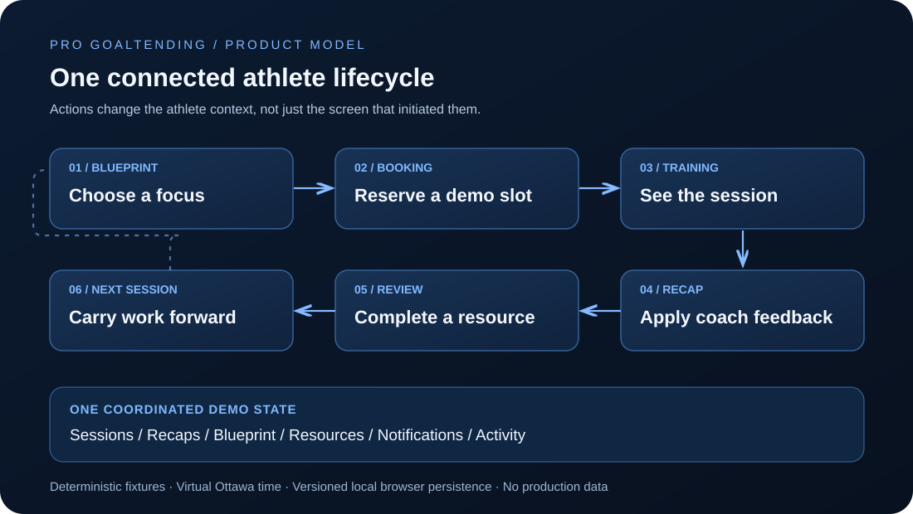

# PRO Goaltending | Athlete Development App

<p align="center">
  <strong>A mobile-first athlete experience that connects booking, training, coaching feedback, assigned review, and a development Blueprint in one continuous workflow.</strong>
</p>

<p align="center">
  Next.js 16 · React 19 · TypeScript · Zustand · Motion · Vitest
</p>

<p align="center">
  <a href="https://progoaltending-app.vercel.app/"><strong>Explore the interactive demo</strong></a>
  &nbsp;·&nbsp;
  <a href="#engineering-center-coordinated-athlete-state"><strong>Engineering</strong></a>
  &nbsp;·&nbsp;
  <a href="ARCHITECTURE.md"><strong>Architecture notes</strong></a>
  &nbsp;·&nbsp;
  <a href="#contribution-and-project-boundaries"><strong>Contribution</strong></a>
</p>

PRO Goaltending began primarily as a self-initiated athlete-product project, was also requested by the organization, and has been used internally. I developed this application prototype to explore an athlete experience beyond a standalone booking screen. Training should inform what an athlete works on, coaching feedback should carry into the next session, and assigned review should remain connected to development priorities.

**The engineering challenge is continuity:** when a session is booked, changed, completed, or reviewed, the surrounding athlete experience should not contradict itself.

> **Public demo boundary:** This is a functional prototype built with fictional athlete, coach, booking, and feedback data—not a copy of PRO Goaltending's production systems or customer records. Real coach names and proprietary training videos are excluded from the public version: coaches use numbered placeholders, and Library reviews use code-drawn diagrams with simulated playback and progress rather than actual footage. Availability, prices, and checkout are also simulated. PRO branding and externally hosted training-card photos are separate public-facing assets; see [asset provenance](docs/ASSET_PROVENANCE.md).

<p align="center">
  
</p>
<p align="center">
  <sub><strong>Core product model:</strong> training is not an isolated transaction. Each stage carries context into the next.</sub>
</p>

## At a glance

| Dimension | Implementation |
| --- | --- |
| **Product** | Mobile-first athlete dashboard, training history, booking, Blueprint, coaching recaps, resources, notifications, and demo controls |
| **Technical centerpiece** | A coordinated Zustand store keeps related product views consistent as session and development actions change state |
| **Domain logic** | Framework-independent session phases, Ottawa date rules, focus-based recommendations, and deterministic availability |
| **Persistence** | Versioned, client-rehydrated browser-local state with curated reset and scenario fixtures |
| **Demo controls** | Virtual Ottawa clock, lifecycle presets, simulated coach events, Presentation Mode, and product tour |
| **Service boundaries** | Deterministic availability, mock payment, calendar export, optional external map/calendar links, and no-op analytics |
| **Verification** | Vitest domain and integration tests, ESLint, TypeScript checking, and Next.js build in the GitHub Actions workflow |
| **My role** | Developed the application prototype and its connected athlete workflows; the organization supplied part of the request and used the result internally |

## Why this product

A training booking tells an athlete **where** to go and **when**. It does not automatically answer what to prepare, which coaching cue to remember, what changed after training, or what to review before the next ice time.

I approached that gap as a product and state-modeling problem. In this demo:

1. A Blueprint focus helps recommend a training format.
2. The athlete chooses a fictional facility, date, time, coach, and simulated checkout method.
3. The new session appears in Training and produces an activity entry and notification.
4. A fictional coach recap can describe what was worked on, assign review, and propose a Blueprint change.
5. The athlete applies that update, completes review, and carries the focus into later training.

The goal is not a claim that the prototype improves athletic performance. It is a concrete demonstration of how the information around training could remain connected.

## Engineering center: coordinated athlete state

The visible screens are intentionally separated, but they do not own separate copies of athlete records. Domain models live in [`src/domain/types.ts`](src/domain/types.ts), while [`src/store/app-store.ts`](src/store/app-store.ts) coordinates related updates through one persistent application store.

| Action | Related state and visible consequences |
| --- | --- |
| **Book a demo session** | Adds a scheduled session; recalculates availability; creates a booking notification and development event; records the confirmation |
| **Cancel a scheduled session** | Changes its status, releases its fictional slot, and records the cancellation |
| **Reschedule a session** | Retains the session identity, changes its time and coach, updates slot occupancy, and records the change |
| **Publish a fictional recap** | Associates feedback with a session and surfaces an athlete notification and activity event |
| **Apply a Blueprint update** | Applies proposed focus statuses, marks the recap as applied, and records the changes without reapplying them |
| **Complete assigned review** | Persists resource progress and records completion once instead of duplicating activity on repeat clicks |

Each action is visible through multiple routes because Home, Training, Blueprint, Library, and Notifications read the same state. Booking and rescheduling validate that the chosen time and coach still match the currently derived fictional availability before committing a state change.

This is intentionally a **single-browser demo consistency model**, not distributed transactions or an authoritative server booking system. A production application would need server-side capacity enforcement and concurrency controls; browser-local guards alone cannot stop bookings from different devices.

### Recommendation and availability are explicit rules

[`recommendSessionType`](src/domain/recommendation.ts) ranks training formats from active Blueprint focuses with fixed weights. It is an inspectable rule, not AI coaching.

[`DemoAvailabilityService`](src/services/availability.ts) derives repeatable fictional slots from facility, format, date, coach identifiers, and booked session state. The booking interface computes its date and facility counts from the actual available options, so a reserved slot changes both the options and the count.

No displayed slot implies that the named facility hosts the fictional session or that PRO has real availability there.

### A local-first presentation that can show different stages

A real training lifecycle unfolds over days or weeks. A useful demo needs to show those states without asking a reviewer to return later.

[`createScenarioState`](src/data/demo-fixtures.ts) supplies scenarios for training today, training soon, completion, pending feedback, published feedback, no upcoming sessions, and multiple scheduled sessions. [`/demo`](https://progoaltending-app.vercel.app/demo) exposes these presets, simulated coach actions, Presentation Mode, a product tour, and complete reset.

- **Virtual time:** contextual session phases use `virtualNowISO`, including the 45-minute "soon" threshold.
- **Ottawa calendar semantics:** date generation and rebasing use `America/Toronto` calendar days instead of assuming every local day lasts 24 hours.
- **Deterministic fixtures:** scenarios return a connected set of sessions, focus history, recaps, resources, notifications, and development events.
- **Persistence:** the `pro-demo-state-v1` storage key retains interactions in one browser; a hydration gate prevents inconsistent initial server/client rendering.
- **Reset:** returns the demonstration to its curated initial data, rather than preserving partially completed actions.

Presentation Mode is a deterministic showcase control. It does not signal a separate coach or administrative account.

## Explore the connected experience

| Route | What to inspect |
| --- | --- |
| [Home](https://progoaltending-app.vercel.app/) | Context-aware next session, active focus, assigned work, and development activity |
| [Book training](https://progoaltending-app.vercel.app/book) | Blueprint-informed recommendation, changing fictional slots, coach choice, and mock checkout |
| [Training](https://progoaltending-app.vercel.app/training) | Upcoming and historical sessions, rescheduling/cancellation, and coaching recaps |
| [Blueprint](https://progoaltending-app.vercel.app/blueprint) | Interactive focus map, priorities, development history, and recap-applied changes |
| [Library](https://progoaltending-app.vercel.app/library) | Assigned resources with stored review progress |
| [Demo controls](https://progoaltending-app.vercel.app/demo) | Lifecycle states, virtual clock, simulated coach events, and reset |

**Suggested demo path:** open Demo controls, choose **Recap Ready**, visit Training and open the latest recap, apply its Blueprint change, then visit Blueprint and Library. Reset the demo before starting a different path.

The resource interface uses predetermined coaching illustrations and progress behavior. It does not ingest real videos, track athlete motion, or perform AI analysis. The mock checkout accepts no payment card data and charges nothing.

## Architecture and deliberate tradeoffs

```text
src/domain       Types, session lifecycle, Ottawa time, recommendation rules
src/data         Fictional fixtures, lifecycle scenarios, date rebasing
src/services     Demo availability, mock payment, calendar/maps, no-op analytics
src/store        Coordinated actions, persisted state, rehydration, reset
src/components   Athlete screens, booking, Blueprint, resources, UI controls
src/app          Next.js routes, metadata, loading and error boundaries, styles
```

[`ARCHITECTURE.md`](ARCHITECTURE.md) describes the data flow, booking and recap invariants, hydration, and replacement boundaries.

| Design choice | Why | Boundary |
| --- | --- | --- |
| One versioned browser store | Keeps a multi-screen demonstration coherent without a backend | Not multi-user, authoritative, or secure storage |
| Deterministic availability | Makes changing booking states reproducible | Does not represent real schedules or inventory |
| Virtual Ottawa time | Makes lifecycle stages reviewable on demand | Not a live coaching-event feed |
| Payment gateway interface | Keeps checkout flow separate from a payment implementation | Only the mock implementation exists |
| No-op analytics | Keeps product event calls without sending analytics data | No adoption or engagement metrics collected |

For a real product, these local boundaries would need authenticated, authorized server APIs; server-side validation and booking concurrency; a payment provider; guardian and minor-account rules where required; audit logs; protected media; appropriate consent, security, and retention controls. None of these are implemented production capabilities.

## Verification

The repository includes deterministic [domain tests](src/domain/product-rules.test.ts) and [lifecycle integration tests](src/domain/lifecycle-integration.test.ts). They cover scenario behavior, session derivation, recommendation, slot capacity, changes across related product state, recap/Blueprint idempotency, reset, and Ottawa daylight saving transitions.

The [verification workflow](.github/workflows/verify.yml) runs linting, TypeScript checks, tests, and the production build on pull requests and main-branch pushes. Workflow presence is not a claim that every possible browser interaction or production deployment has been tested.

### Run locally

Requires Node.js 20.9 or newer and npm. Node.js 22 is used in CI.

```bash
npm ci
npm run dev
```

Open `http://localhost:3000`. To check the project:

```bash
npm run lint
npm run typecheck
npm test
npm run build
npm start
```

The demo does not need application API credentials or a database. Next.js obtains Google font assets at build time and serves them with the app; builds may require network access. Training-card backgrounds are fetched from PRO's public website at runtime. Maps and Google Calendar links open third-party sites only when chosen.

## Contribution and project boundaries

I developed the athlete application prototype. The idea was primarily self-initiated, was also requested by PRO Goaltending, and the result has been used internally. That context explains the practical sports domain, but **internal use does not establish customer deployment, commercial adoption, business impact, or ownership of PRO's operations**. The public demonstration is a separate fictional environment, not a connected production account.

The PRO name, logo, and training-card imagery are used with permission. See [asset notes](docs/ASSET_PROVENANCE.md) for bundled versus externally hosted assets.

Public demo fixtures were created as fictional examples rather than anonymized exports of private athlete or coaching records. There are no real athlete profiles, customer records, private coaching messages, proprietary training videos, real price feeds, payment credentials, or analytics telemetry in the demo. Coach identifiers and coaching content are fictional. A production deployment would require authorization and personal-data protections rather than relying on this browser-local store.

**Known limitations:** browser-local persistence, no authentication or shared backend, fictional facilities and capacities, mock payment, predetermined resource playback, no live notifications, no real coaching integration, and no measured adoption results. Authentic application captures are not yet committed; see the [capture checklist](docs/DEMO_CAPTURE.md) for reproducible visual evidence requirements.
